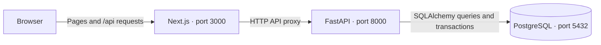

# LeadFlow

A lead tracker built with Next.js, FastAPI, and PostgreSQL. Manage leads, discussion history, statuses, and follow-ups.

## Start with Docker

Install **Git** and **Docker Desktop**. Start Docker Desktop with Linux containers. You do not need Python or Node.js for this option.

The commands below use PowerShell.

### 1. Open the project

For a new checkout:

```powershell
git clone https://github.com/pratapVansh/LeadFlow.git "$env:USERPROFILE\source\LeadFlow"
Set-Location "$env:USERPROFILE\source\LeadFlow"
```

Already cloned? Open a terminal in your project folder instead. On Windows, keep it **outside OneDrive**; cloud file tags can cause Docker's `invalid file request Dockerfile` error.

### 2. Create your configuration

From the project root:

```powershell
if (!(Test-Path .env)) { Copy-Item .env.example .env }
```

Open **`.env`** and replace the password placeholder before your first startup. The other values are usable defaults:

```dotenv
POSTGRES_USER=leadflow
POSTGRES_PASSWORD='replace_with_a_strong_password'
POSTGRES_DB=leadflow
POSTGRES_TEST_DB=leadflow_test
POSTGRES_PORT=5433
FRONTEND_PORT=3000
BACKEND_PORT=8000
```

- `POSTGRES_USER` / `POSTGRES_PASSWORD`: database login.
- `POSTGRES_DB`: application database.
- `POSTGRES_TEST_DB`: separate test database; its name must end in `_test`.
- The three ports control access from your computer. Change them if a port is already in use.

Keep real credentials only in the root `.env`, which Git ignores. Commit `.env.example` with placeholders. No backend/frontend environment files or database URLs are needed.

**Existing database:** keep its current credentials. Editing `.env` does not change the password stored in PostgreSQL.

### 3. Build and start

```powershell
docker compose up --build -d --wait
docker compose ps
```

Open these addresses with the default ports:

| Service | Address |
| --- | --- |
| App | http://localhost:3000 |
| API documentation | http://localhost:8000/docs |
| Database health | http://localhost:8000/api/health |

Startup creates the tables and adds **6 sample leads with 3 discussions each** when the leads table is empty. Existing records are preserved.

## How it works



The browser uses the frontend's `/api` address. Next.js forwards requests to FastAPI, which validates input and saves changes in PostgreSQL. Successful responses update the list immediately.

Docker uses `backend:8000` and `db:5432` internally. The database is accessible from your computer on `POSTGRES_PORT` (5433 by default). Its named volume keeps data across container restarts.

## Use the app

- **Add New Lead:** name is required; company and phone are optional. Status starts as New.
- **Filters and search:** filter by any of six statuses or search by name. Today's follow-ups appear first; overdue reminders are red.
- **Timeline:** click a lead to see discussions newest first, add a note, or change status.
- **Set Follow-up:** choose a future date and time. **Clear follow-up** removes the active reminder while keeping discussion history.

Saving a note without a new schedule, or changing status, preserves the active reminder. Dates display in your local time zone and are stored in UTC.

## Stop, restart, and logs

Run these from the project root:

| Action | Command |
| --- | --- |
| View recent logs | `docker compose logs --tail 100 backend frontend` |
| Stop services | `docker compose stop` |
| Start them again | `docker compose up -d --wait` |
| Rebuild after code changes | `docker compose up --build -d --wait` |
| Remove containers, keep data | `docker compose down` |

**`docker compose down -v` deletes the database volume and all leads/discussions.** Use it only when you intend to reset your data.

## Local development (optional)

Requires **Python 3.12**, **Node.js 22.12+**, and the root `.env` from step 2.

From the project root, start the database. If Docker's HTTP services are already running, stop them to free their ports:

```powershell
docker compose up -d --wait db
docker compose stop frontend backend
```

**Terminal 1 — backend**, starting from the project root:

```powershell
Set-Location backend
python -m venv .venv
.\.venv\Scripts\python.exe -m pip install -r requirements-dev.txt
.\.venv\Scripts\python.exe -m app.seed
.\.venv\Scripts\python.exe -m app.local
```

**Terminal 2 — frontend**, starting from the project root:

```powershell
Set-Location frontend
npm ci
npm run dev
```

Both launchers read the root configuration. Install Node dependencies on the operating system where you run them; Windows and Linux native binaries differ.

## Tests

Start the full Docker app using step 3; stop local servers first if they use the same ports. Create an empty test database **once** using your configured `POSTGRES_USER` and `POSTGRES_TEST_DB`. With the defaults above:

```powershell
docker compose exec -T db createdb -U leadflow leadflow_test
docker compose exec -T backend python -m pytest -q
docker compose exec -T backend python -m pip check
docker compose config --quiet
```

Skip `createdb` if the test database already exists. Backend tests refuse the application database or a test database containing leads.

For frontend checks, install Node.js and run these from `frontend`:

```powershell
npm ci
npm test
npm run typecheck
npm run build
```

## Scope

This is a local assessment app without authentication. Published Docker ports bind to localhost. Initial tables are created automatically; schema migrations are not included.
